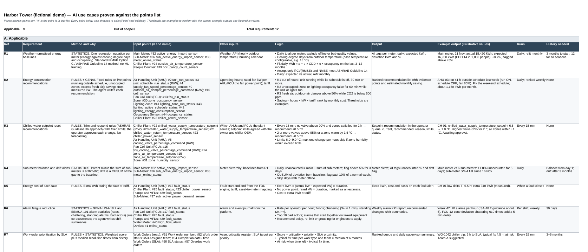

# PointProof

**Every AI claim, proven point by point.**

PointProof is an open-source agent skill for building and industrial AI scoping. Give it a site's points list and a list of AI requirements (a tender, an RFP, a wish list). It tells you, for each one:

- **applicable or out of scope**
- the **simplest method** that works: rules → statistics → ML, plus GenAI when language is involved
- the **exact points** it needs, by id and name from *your* list
- the **logic**, the **output** and an **example output**
- what is **missing** from the list

Then it builds a one-sheet Excel report. Before the report is built, a validator checks every referenced point against the points list. If the agent cites a point that does not exist, the run fails.



## Why

In building and OT tenders, "AI" requirements are often met by fixed rules or plain statistics: a degree-day regression baseline, a meter balance check, ISA-18.2 alarm statistics, a trim-and-respond setpoint rule. Teams over-promise ML they don't need, or under-scope because no one has checked the points. PointProof makes that check fast and defensible.

## Install

**Claude Code (plugin)**

```
/plugin marketplace add flamewithcodeossoss/pointproof
/plugin install pointproof@pointproof
```

**Any agent that reads Agent Skills (Claude Code, Codex, Cursor, OpenCode…)**

```
npx skills add flamewithcodeossoss/pointproof --skill pointproof
```

**Manual**: copy `skills/pointproof/` into your agent's skills folder (for Claude Code: `~/.claude/skills/` or `.claude/skills/`).

Python 3.9+ with `pip install -r requirements.txt`.

## Use

```
Use pointproof on points.xlsx and requirements.csv.
Our team delivers rules and statistics, not ML.
```

The agent runs four steps:

```
points list ──► parse_points.py ──► points.json
                                        │
use-case library ──► match_usecases.py ─┴─► candidates.json
                                                │
requirements ──► agent writes assessment.json ◄─┘
                         │
                 validate.py   (no invented points, method policy)
                         │
                 build_report.py ──► PointProof_report.xlsx
```

You can also run the scripts yourself:

```bash
S=skills/pointproof/scripts
python $S/parse_points.py examples/harbor-tower/points.csv --out points.json
python $S/match_usecases.py points.json --out candidates.json
python $S/validate.py examples/harbor-tower/assessment.json points.json --max-method statistics
python $S/build_report.py examples/harbor-tower/assessment.json points.json --out report.xlsx
```

## The method ladder

| Rung | Method | Example |
|---|---|---|
| 1 | rules | Equipment running outside schedule; fault energy cost; chilled-water setpoint trim-and-respond |
| 2 | statistics | Degree-day baselines (IPMVP, ASHRAE Guideline 14); CUSUM drift; ISA-18.2 alarm KPIs |
| 3 | ml | Demand forecasting; remaining useful life |
| + | genai | Copilot answers, explanations, incident reports |

`--max-method statistics` enforces a "no ML" policy: any applicable item that needs ML fails validation.

## What's inside

| Path | What it is |
|---|---|
| `skills/pointproof/SKILL.md` | The skill the agent follows |
| `skills/pointproof/references/usecases.yaml` | 20 generic use cases with the point patterns each needs |
| `skills/pointproof/references/method_ladder.md` | How to pick rules, statistics, ML or GenAI |
| `skills/pointproof/references/assessment_schema.md` | The assessment format |
| `skills/pointproof/scripts/` | Parser, matcher, validator, report builder |
| `examples/harbor-tower/` | A fictional building: 59 points, 12 requirements, full output |

## Roadmap

- Brick and Project Haystack model import (TTL, Zinc/JSON)
- Export runnable rule packs (SQL / Python) for the applicable rules
- More use cases: water leaks, lifts, IAQ, waste, cleaning
- Arabic report option

## Contributing

New use cases are the most useful contribution: add one to `usecases.yaml` with its slots, method and logic, keep it generic (no client data), and include a test.

## License

MIT. The demo building is fictional. PointProof is not affiliated with any standard body; standards are cited for method references only.
