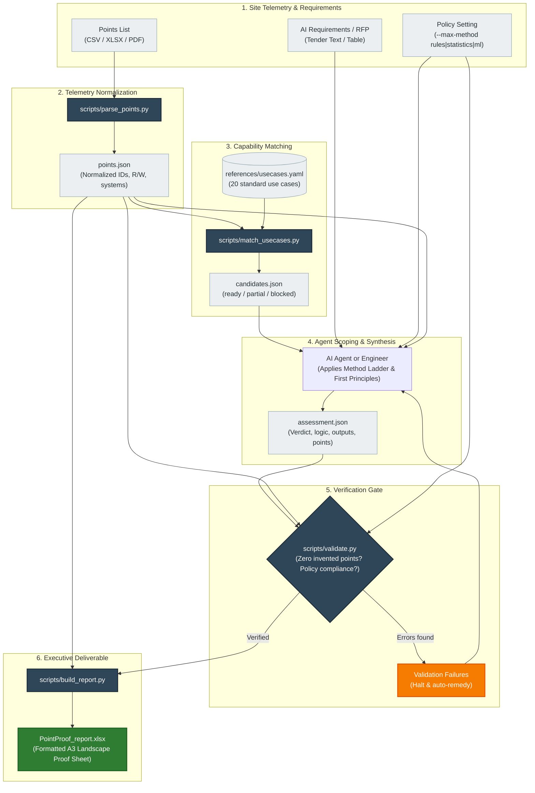
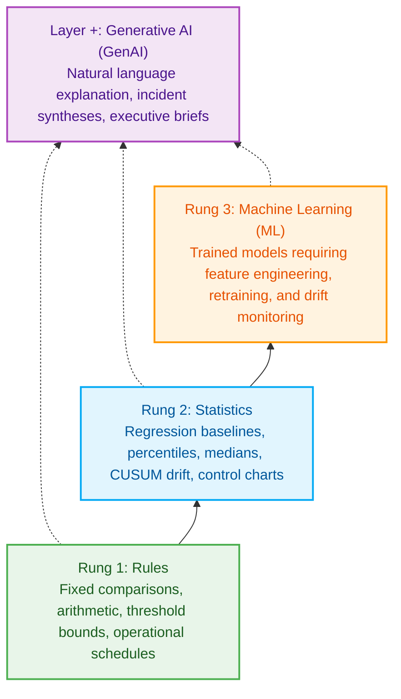

<div align="center">


# PointProof

### *Every AI claim, proven point by point.*

[](https://github.com/flamewithcodeossoss/pointproof/actions/workflows/test.yml)
[](https://github.com/flamewithcodeossoss/pointproof)
[](https://www.python.org/)
[](LICENSE)
[](skills/pointproof)
[](https://github.com/flamewithcodeossoss/pointproof/pulls)

**PointProof** is an open-source agent skill and specification engine for building, OT, and industrial AI scoping.

Given a site's raw telemetry points list (BMS, SCADA, IoT, CMMS) and a tender RFP requirement list, PointProof deterministically validates what can actually be delivered, enforces the simplest defensible method, binds exact physical points without hallucinations, and compiles an executive-ready Excel proof matrix.

[Why PointProof?](#why-pointproof) • [How It Works](#how-it-works) • [Quickstart](#quickstart) • [The Method Ladder](#the-method-ladder) • [Use-Case Library](#built-in-use-case-library) • [CLI Reference](#cli-reference) • [Walkthrough](#example-walkthrough-harbor-tower) • [Contributing](#contributing)

</div>

---

## Table of Contents

- [Why PointProof?](#why-pointproof)
  - [The AI Scoping Trap in Smart Buildings](#the-ai-scoping-trap-in-smart-buildings)
  - [The PointProof Guarantee](#the-pointproof-guarantee)
- [How It Works](#how-it-works)
  - [Pipeline Architecture](#pipeline-architecture)
  - [The Method Ladder](#the-method-ladder)
- [Quickstart](#quickstart)
  - [1. For Claude Code](#1-for-claude-code)
  - [2. For Universal Coding Agents (Codex, Cursor, OpenCode)](#2-for-universal-coding-agents-codex-cursor-opencode)
  - [3. For Python & CLI Users](#3-for-python--cli-users)
- [Example Walkthrough: Harbor Tower](#example-walkthrough-harbor-tower)
  - [The Challenge](#the-challenge)
  - [The Execution](#the-execution)
  - [The Result](#the-result)
- [The Report Structure](#the-report-structure)
- [Built-in Use-Case Library](#built-in-use-case-library)
- [CLI Reference](#cli-reference)
  - [`parse_points.py`](#parse_pointspy)
  - [`match_usecases.py`](#match_usecasespy)
  - [`validate.py`](#validatepy)
  - [`build_report.py`](#build_reportpy)
- [Assessment Schema Specification](#assessment-schema-specification)
- [Development & Testing](#development--testing)
- [Roadmap](#roadmap)
- [Contributing](#contributing)
- [License & Disclaimers](#license--disclaimers)

---

## Why PointProof?

### The AI Scoping Trap in Smart Buildings

In smart facility tenders, commercial real estate RFPs, and industrial automation bids, client requirements for "Artificial Intelligence" are routinely vague and over-scoped:

> *"The solution shall provide AI-driven continuous predictive optimization of chiller plants, fault detection with root-cause identification, and GenAI automated work orders."*

When responding to these tenders, delivery teams face two major risks:

1. **The Over-Promise Trap**: Promising complex neural networks, deep reinforcement learning, or unconstrained GenAI copilots when the underlying physics are already solved by deterministic engineering rules or classical statistical regressions (e.g., ASHRAE Guideline 14 baselines, ISA-18.2 alarm management, setpoint trim-and-respond).
2. **The Telemetry Disconnect**: Bidding on use cases that require specific sensors (e.g., kW sub-meters, outdoor air temperature, static pressure, differential temperature, or writable control points) without checking if those points physically exist in the building's BMS or SCADA schedule. When delivery begins, teams discover critical sensors are missing, writable points are locked as read-only, or naming conventions are inconsistent.

### The PointProof Guarantee

| Traditional AI Bidding | PointProof Spec-Driven Scoping |
|:---|:---|
| **Vague Promises**: Generic marketing slides claiming "state-of-the-art ML". | **Deterministic Grounding**: Every algorithm cites exact, numbered point IDs from the building schedule. |
| **Hallucinated Sensors**: Algorithms assume perfect data that does not exist on site. | **Validator Zero-Tolerance**: If an agent or engineer references a point ID not in the file, execution halts. |
| **Black-Box Overkill**: Deep models proposed where a degree-day regression is superior. | **Occam's Razor (The Method Ladder)**: Rules before Statistics; Statistics before Machine Learning. |
| **Costly Scope Creep**: Missing hardware discovered months into contract delivery. | **Upfront Gap Analysis**: Hardware and master data deficits are flagged directly in Section C of the report. |
| **Manual Spreadsheet Juggling**: Hours spent cross-referencing I/O schedules by hand. | **Automated Ingestion**: Ingests CSV, XLSX, or PDF tables and produces an A3 executive workbook in seconds. |

---

## How It Works

PointProof operates as both an **Autonomous Agent Skill** (for Claude Code, Cursor, Codex, and other LLM assistants) and a **Deterministic CLI Toolkit**.

### Pipeline Architecture



---

### The Method Ladder

PointProof enforces **Occam's razor** in algorithmic design: *always choose the lowest rung that satisfies the objective*.



#### Decision Matrix

| Rung | Method | Use When | Industrial / Building Examples |
|:---:|:---|:---|:---|
| **1** | `rules` | A physical relation, arithmetic formula, or Boolean logic answers the requirement. | Equipment running out-of-hours; cooling setpoint trim-and-respond; fault energy cost calculations; economizer damper lockouts. |
| **2** | `statistics` | It requires fitting a line, calculating a percentile/median, or monitoring a running sum without model retraining pipelines. | Weather-normalized energy baselines (IPMVP Option C, ASHRAE Guideline 14); CUSUM meter drift; ISA-18.2 alarm KPIs; portfolio EUI benchmarking. |
| **3** | `ml` | Accuracy depends on learning high-dimensional non-linear patterns that require ongoing training pipelines, cross-validation, and drift tracking. | 24–72 hour day-ahead peak electrical demand forecasting; chiller compressor remaining useful life (RUL); learned thermal inertia predictive models. |
| **+** | `genai` | Human language is involved in input or output: querying systems in plain English, explaining a complex anomaly, or generating incident timelines. | Operator Copilot natural-language querying; automated shift turnover briefs; contextualized work-order summaries. |

> [!NOTE]
> `genai` is not a replacement for numerical computation; it sits on top of whichever underlying rung computes the numbers. Calling a regression baseline an "AI Model" is prohibited under PointProof verification standards.

---

## Quickstart

### 1. For Claude Code

PointProof is packaged as an official Claude Code plugin and skill.

```bash
# Add the marketplace and install
/plugin marketplace add flamewithcodeossoss/pointproof
/plugin install pointproof@pointproof
```

Once installed, invoke PointProof inside any conversation:

```text
Use pointproof on points.xlsx and tender_requirements.csv.
Our team delivers rules and statistics, not ML.
```

### 2. For Universal Coding Agents (Codex, Cursor, OpenCode)

PointProof supports the universal Agent Skills standard:

```bash
npx skills add flamewithcodeossoss/pointproof --skill pointproof
```

Alternatively, copy `skills/pointproof/` directly into your agent's skill directory:
- Claude Code: `~/.claude/skills/pointproof`
- Cursor / OpenCode / Antigravity: `.agents/skills/pointproof` or `.gemini/skills/pointproof`

### 3. For Python & CLI Users

Install standard dependencies (Python 3.9+):

```bash
git clone https://github.com/flamewithcodeossoss/pointproof.git
cd pointproof
pip install -r requirements.txt
```

Run the pipeline manually:

```bash
# Set scripts directory
S=skills/pointproof/scripts

# 1. Parse raw points list (CSV, XLSX, or PDF)
python $S/parse_points.py examples/harbor-tower/points.csv --out points.json

# 2. Check candidate use-case matches against the library
python $S/match_usecases.py points.json --out candidates.json

# 3. Validate your scoping assessment against physical points
python $S/validate.py examples/harbor-tower/assessment.json points.json --max-method statistics

# 4. Generate the formatted executive Excel proof sheet
python $S/build_report.py examples/harbor-tower/assessment.json points.json --out PointProof_report.xlsx
```

---

## Example Walkthrough: Harbor Tower

The repository includes a complete reference dataset based on **Harbor Tower**, a fictional 35-storey mixed-use commercial asset.

### The Challenge

- **Points Schedule**: 59 physical points spanning BMS, Energy Sub-meters, IAQ, Lighting, and CMMS.
- **Tender Scope**: 12 diverse AI & advanced analytics requirements from an RFP.
- **Delivery Mandate**: The engineering team delivers deterministic rules and statistical baselines, but has a policy against deploying unverified Machine Learning pipelines (`--max-method statistics`).

### The Execution

1. **Telemetry Ingestion**:
   ```bash
   python skills/pointproof/scripts/parse_points.py examples/harbor-tower/points.csv --out points.json
   ```
   *Output*: Ingests 59 points across 7 subsystems (31 BMS, 9 CMMS, 7 Energy, 4 IAQ, 4 Lighting, 2 Water, 2 People Counting). Identifies 9 writable (R/W) control setpoints.

2. **Matching Against 20 Standard Use Cases**:
   ```bash
   python skills/pointproof/scripts/match_usecases.py points.json --out candidates.json
   ```
   *Output*: Matches requirements against `references/usecases.yaml`. Determines that baseline regressions, out-of-hours detection, and setpoint resets have all required telemetry (`ready`), while deep demand forecasting is flagged as ML.

3. **Verification Gate**:
   ```bash
   python skills/pointproof/scripts/validate.py examples/harbor-tower/assessment.json points.json --max-method statistics
   ```
   *Output*:
   ```text
   12 items: 9 applicable, 3 out of scope; 39 distinct points referenced; policy max method: statistics
   PASSED: every referenced point exists in the points list
   ```

4. **Deliverable Generation**:
   ```bash
   python skills/pointproof/scripts/build_report.py examples/harbor-tower/assessment.json points.json --out PointProof_report.xlsx
   ```

### The Result

An executive-ready, audit-grade proof workbook:


---

## The Report Structure

`PointProof_report.xlsx` is compiled on a single, print-ready, high-density landscape A3 worksheet divided into five cohesive sections:

```
┌────────────────────────────────────────────────────────────────────────────────────────┐
│  PointProof Executive Report: Harbor Tower — AI use cases proven against points list   │
│  Summary: 9 Applicable  |  3 Out of Scope  |  12 Total Requirements                     │
├────────────────────────────────────────────────────────────────────────────────────────┤
│  SECTION A. APPLICABLE REQUIREMENTS                                                    │
│  [Ref] [Title] [Method & Why] [Input Points] [Other Inputs] [Logic] [Output] [Runs]    │
│  • R1: Energy baseline (STATISTICS) -> Points: #41 Active Energy, #7 Outdoor Temp      │
│  • R3: Fault energy cost (RULES)    -> Points: #17 Chilled Water Temp, #21 Flow Rate   │
│  • R5: CHW reset (RULES)           -> Points: #22 CHW Supply Temp SP (R/W)             │
│  ...                                                                                   │
├────────────────────────────────────────────────────────────────────────────────────────┤
│  SECTION B. OUT OF SCOPE                                                               │
│  [Ref] [Requirement Title]                                                             │
│  • R7: 24-72h demand forecast (Requires ML above organizational policy)                │
│  • R8: Chiller Remaining Useful Life (Requires vibration sensors not in schedule)      │
├────────────────────────────────────────────────────────────────────────────────────────┤
│  SECTION C. MISSING POINTS AND DATA TO REQUEST                                         │
│  [Ref] [Needed Telemetry / Master Data]                                                │
│  • R1: Building gross floor area (master data)                                         │
│  • R3: Electricity tariff schedule ($/kWh peak / off-peak)                            │
├────────────────────────────────────────────────────────────────────────────────────────┤
│  SECTION D. POINTS USED PER SYSTEM                                                     │
│  [System]               [Points in List]     [Points Used]        [Share Used]         │
│  • BMS                  31                   19                   61%                  │
│  • Energy Sub-meters     7                    7                  100%                  │
│  • Total                59                   39                   66%                  │
├────────────────────────────────────────────────────────────────────────────────────────┤
│  SECTION E. ARCHITECTURE & GOVERNANCE                                                  │
│  [Layer]                [What it does]       [Data & Points]      [Owner]              │
│  • Edge Gateway         Modbus/BACnet poll   Real-time telemetry  BMS Vendor           │
│  • Analytics Engine     FDD & Stat baselines Stored time-series   Data Engineering     │
└────────────────────────────────────────────────────────────────────────────────────────┘
```

---

## Built-in Use-Case Library

PointProof ships with **22 building, energy and domain-agnostic use cases** in [`references/usecases.yaml`](skills/pointproof/references/usecases.yaml). Each entry defines required and optional telemetry slots, regex patterns for point names, optional units patterns, exclude rules, and citations to international engineering standards. Matching ignores naming style (`run_status`, `Run Status`, `RunStatus` and `RUN-STATUS` are the same) and folds accents, so the library works on DBO, Brick, Haystack, vendor tags or plain-language descriptions. For other domains, add your own pack with `--library` (see below):

| ID | Title | Method | Standard Reference | Telemetry Slots Required |
|:---|:---|:---:|:---|:---|
| `energy-baseline` | Weather-normalised energy baseline | `statistics` | IPMVP Option C, ASHRAE 14 | Energy meter kWh (`#`), Outdoor temp |
| `meter-balance-drift` | Meter balance & drift detection | `statistics` | CUSUM Control Charts | Parent & child meters, connectivity |
| `portfolio-benchmarking` | Portfolio EUI benchmarking | `statistics` | ISO 50001, ENERGY STAR | Energy meters, floor area, weather |
| `fault-energy-cost` | Continuous fault energy cost | `rules` | ASHRAE Standard 90.1 | Power/thermal energy, setpoint drift |
| `ecm-out-of-hours` | Equipment running outside schedule | `rules` | ASHRAE Standard 90.1 | Equipment run status, schedule |
| `ecm-unoccupied-conditioning` | Conditioning unoccupied spaces | `rules` | EN 16798 | Occupancy count/state, zone temp SP |
| `ecm-excess-fresh-air` | Economizer & fresh air optimization | `rules` | ASHRAE 62.1 | CO2 ppm, damper position, flow rate |
| `chw-setpoint-reset` | Chilled water temp trim & respond | `rules` | ASHRAE Guideline 36 | CHW supply temp SP (writable), valve % |
| `zone-setback` | Smart night/weekend setback | `rules` | ASHRAE 90.1 | Zone temp SP (writable), occupancy |
| `alarm-kpis` | Alarm rate, flood & chattering KPIs | `statistics` | ISA-18.2, EEMUA 191 | Alarm trip states, priority tags |
| `maintenance-prioritisation` | Rule-based maintenance triage | `rules` | ISO 55000 | Equipment run hours, filter DP |
| `work-order-prioritisation` | CMMS backlog & SLA prioritization | `rules`+`statistics` | Best practice CMMS | Open tickets, SLA due date, priority |
| `carbon-trajectory` | Scope 1 & 2 carbon tracking | `statistics` | GHG Protocol Scope 1/2 | Fuel & electricity kWh, grid factors |
| `retrofit-roi` | Measurement & verification of ECMs | `rules` | IPMVP Option B / C | Post-retrofit baseline, utility cost |
| `copilot-nlq` | Facility natural language queries | `genai` | Operator Copilot | Any validated points in schedule |
| `incident-timeline` | Automated incident synthesis | `genai` | Incident Post-Mortem | System alarms, operator actions |
| `equipment-degradation` | Heat exchanger fouling & degradation | `statistics` | Heat transfer fouling models | Entering/leaving temps, flow rate |
| `demand-forecast` | 24–72 h day-ahead peak forecasting | `ml` | Deep learning / XGBoost | Multi-year historical load, weather API |
| `remaining-useful-life` | Bearing & motor vibration RUL | `ml` | Predictive Maintenance (PdM) | High-frequency vibration, bearing temp |
| `occupancy-forecast` | Building occupancy forecasting | `ml` | Space planning models | Historical turnstile / camera counts |
| `sensor-data-quality` | Flatline, range, spike and gap checks (any domain) | `rules` | — | Any analog measurement, comms status |
| `short-cycling` | Motor, pump, compressor or unit short-cycling (any domain) | `rules` | — | Run status, optional power |

---

## CLI Reference

All scripts reside in [`skills/pointproof/scripts/`](skills/pointproof/scripts/) and execute on Python 3.9+ with zero complex native binary dependencies.

### `parse_points.py`

Normalizes heterogeneous points schedules into a uniform schema (`points.json`).

```bash
python parse_points.py POINTS_FILE [--sheet NAME] [--out points.json] [--map field=Header ...]
```

- **Arguments**:
  - `POINTS_FILE`: Path to a `.csv`, `.tsv`, `.txt`, `.xlsx`, `.xlsm`, or `.pdf` file. CSV delimiter (`,` `;` tab `|`) and encoding (UTF-8 or Windows-1252) are detected.
  - `--sheet NAME`: Sheet name for multi-tab Excel workbooks (defaults to the sheet with the best header row, so cover and revision sheets are skipped).
  - `--out PATH`: Destination path (defaults to `points.json`). Automatically creates parent folders.
  - `--map field=Header`: Explicit column overrides (e.g. `--map name="BACnet Tag" equipment="Asset Class"`).
- **Extracted Fields**: `id`, `system`, `equipment`, `description`, `name`, `rw` (Read/Write), `units`, `asset`.
- **Header detection**: exact synonyms first, then a synonym as whole words inside a longer header (`Tag Name (DBO)`, `Units of Measure`). A single tag or description column is enough.
- **`rw`** is normalised to `R`, `W`, `R/W` or empty (unknown) from values such as `Read/Write`, `RW`, `Input`/`Output`, or I/O types `AI` `AO` `BI` `BO` `DI` `DO` `AV` `BV`.
- **Repeated ids** (e.g. numbering that restarts per panel) are kept with ids like `12-2` and a warning; exact duplicate rows are dropped.

---

### `match_usecases.py`

Screens the site points list against the standard use-case library.

```bash
python match_usecases.py points.json [--library pack.yaml ...] [--add-builtin] [--out candidates.json]
```

- **Arguments**:
  - `points.json`: Normalized points output from `parse_points.py`.
  - `--library PATH`: Custom YAML library (defaults to `references/usecases.yaml`). Repeat it to combine packs; a later pack replaces a use case with the same id.
  - `--add-builtin`: Load the built-in library first, then the `--library` packs.
- **Writable slots**: when the points list has no read/write data at all, writable slots match on name only and are marked `writable_unverified`.
  - `--out PATH`: Output candidate JSON (defaults to `candidates.json`).
- **Match Statuses**:
  - `ready`: All mandatory telemetry slots find at least one valid point.
  - `partial`: At least one required slot is filled, but others remain unfilled.
  - `blocked`: Zero mandatory slots can be satisfied by the points list.

---

### `validate.py`

The core integrity barrier. Verifies that no point IDs or point names are hallucinated, and enforces algorithmic policy limits.

```bash
python validate.py assessment.json points.json [--max-method rules|statistics|ml]
```

- **Validation Rules (Exit Code 1 on Failure)**:
  - Every point ID cited must exist in `points.json`.
  - Every point name cited must strictly match the name in `points.json`.
  - No applicable item may have empty points without an explicit `no_points_reason`.
  - No method may exceed the specified `--max-method` ceiling.
  - Every requirement must have a unique `ref` and a valid verdict (`applicable` or `out_of_scope`).

---

### `build_report.py`

Compiles the final audit-grade Excel deliverable.

```bash
python build_report.py assessment.json points.json [--out PointProof_report.xlsx]
```

- **Arguments**:
  - `assessment.json`: The agent or engineer's validated assessment file.
  - `points.json`: The normalized points schedule.
  - `--out PATH`: Output workbook destination (defaults to `PointProof_report.xlsx`).
- **Safety**: Automatically runs `validate.py` before touching the workbook. If validation fails, report generation aborts immediately.

---

## Assessment Schema Specification

When an agent or engineer scopes an RFP, they produce `assessment.json`. The schema is documented below:

```json
{
  "project": "Harbor Tower (Commercial Office Demo)",
  "points_source": "harbor_tower_points.csv",
  "policy": {
    "max_method": "statistics"
  },
  "items": [
    {
      "ref": "R1",
      "title": "Weather-normalised energy baseline",
      "verdict": "applicable",
      "usecase": "energy-baseline",
      "method": ["statistics"],
      "why": "One regression equation per meter; no ML training required.",
      "points": [
        {"id": 41, "name": "active_energy_import_sensor"},
        {"id": 7, "name": "outdoor_air_temperature_sensor"}
      ],
      "other_inputs": "Weather API (hourly OAT); building calendar.",
      "logic": [
        "Aggregate daily cumulative kWh per main meter.",
        "Calculate daily cooling degree days (base 18.3°C).",
        "Fit linear model kWh = a + b * CDD on 12-month rolling window.",
        "Compute daily deviation: (Actual - Expected) / Expected."
      ],
      "output": "Tags per meter: expected_kwh, deviation_pct; monthly CV(RMSE).",
      "example": "Main meter, 21 Nov: actual 18,420 kWh; expected 16,950 kWh; deviation +8.7%.",
      "runs": "Daily; refit monthly",
      "history": "3 months minimum; 12 months recommended",
      "missing": ["Gross floor area per tenant (master data)"]
    },
    {
      "ref": "R7",
      "title": "24–72 h electrical peak demand forecast",
      "verdict": "out_of_scope",
      "reason": "Needs a trained ML model; team policy is statistics."
    }
  ],
  "architecture": [
    {
      "layer": "Field Systems & BMS",
      "does": "Direct digital control of chillers, AHUs, and lighting loops",
      "data": "BACnet/IP and Modbus telemetry",
      "owner": "BMS Controls Contractor"
    },
    {
      "layer": "Analytics & Proof Engine",
      "does": "Calculates baseline regressions, FDD rules, and daily deviations",
      "data": "PointProof verified points feed",
      "owner": "Energy Engineering Team"
    }
  ]
}
```

---

## Development & Testing

PointProof adheres to strict quality and test-driven standards.

### Running Unit Tests

```bash
# Run pytest across the complete test suite
pytest -v
```

The test suite validates:
- Ingestion across standard and unusual CSV/Excel encodings.
- Detection of repeated headers in multi-page tables.
- Verification of slot matching regex patterns and exclusion rules.
- Strict rejection of invented point IDs and altered point names.
- Policy boundary enforcement across the Method Ladder.
- Dynamic nested directory creation for report builds.
- Excel formula integrity and cell formatting.

### Continuous Integration

Every push and pull request is automatically tested across Python versions via GitHub Actions (`.github/workflows/test.yml`).

---

## Roadmap

- [ ] **Brick Schema & Project Haystack Ingestion**: Direct import of RDF/Turtle (`.ttl`) and Haystack Zinc/JSON models.
- [ ] **Automated Rule-Pack Compilers**: Export verified `rules` items into runnable Python, SQL, or BACnet control scripts.
- [ ] **Expanded Industrial Libraries**: Dedicated use-case packs for Water Treatment, Data Centers, and Cold-Chain Logistics.
- [ ] **Multi-Lingual Executive Sheets**: Native localized reporting in Arabic, French, Spanish, and German.
- [ ] **Live Telemetry Connectors**: BACnet/IP discovery and MQTT sparkplug ingestion directly into PointProof.

---

## Contributing

We welcome contributions from building automation engineers, energy analysts, and AI practitioners!

### How to Add a New Use Case

The most valuable contribution is expanding [`skills/pointproof/references/usecases.yaml`](skills/pointproof/references/usecases.yaml):

1. **Pick an established domain standard** (e.g. ASHRAE, ISO, ISA, CUSUM, IPMVP).
2. **Define telemetry slots** with clear regex naming patterns.
3. **Specify the lowest defensible rung** on the Method Ladder.
4. **Ensure anonymity**: Never include client-specific or proprietary point tags.
5. **Add a test case** in `tests/test_pointproof.py` to verify that your slot patterns match properly.

Please review our [Contributing Guidelines](CONTRIBUTING.md) and adhere to the project's code of conduct.

---

## License & Disclaimers

- **License**: Released under the [MIT License](LICENSE).
- **Demo Building**: The "Harbor Tower" dataset and associated points are entirely fictional and designed solely for demonstration and test verification.
- **Standards Affiliation**: PointProof is an independent open-source project. Citations of international standards (ASHRAE, IPMVP, ISO, ISA, EEMUA) are provided for technical reference and methodology alignment only.

---

<div align="center">
<sub>Built with precision for the smart building & industrial AI engineering community.</sub>
</div>
