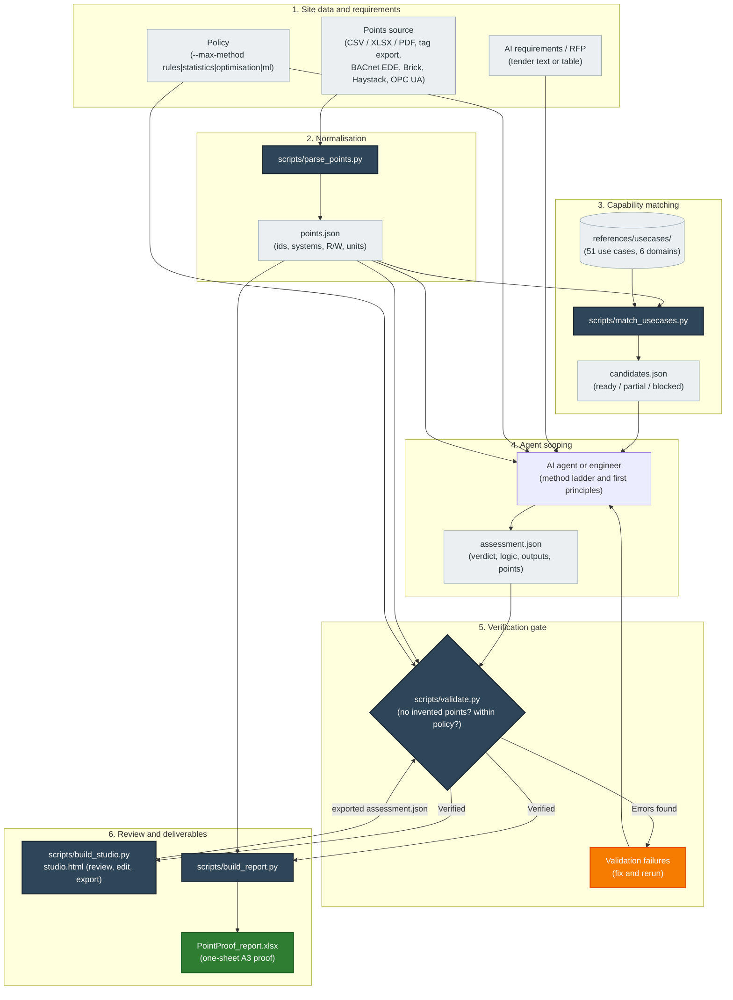
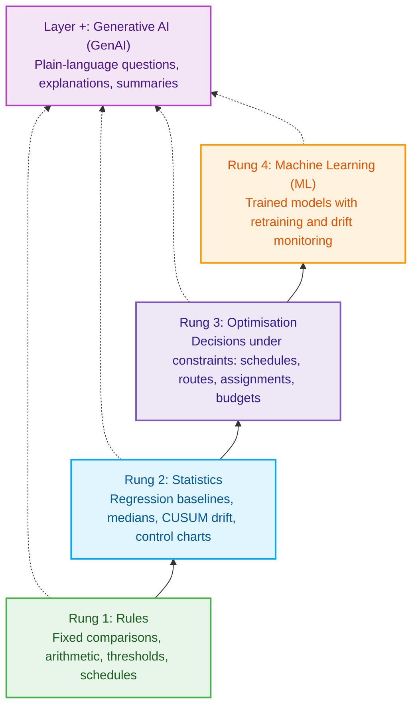
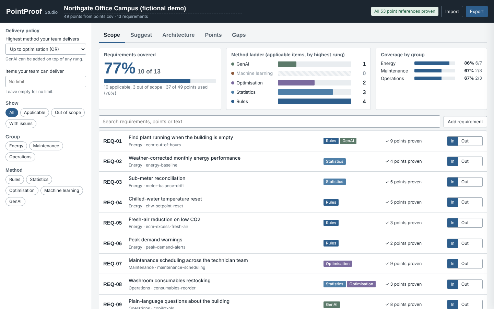
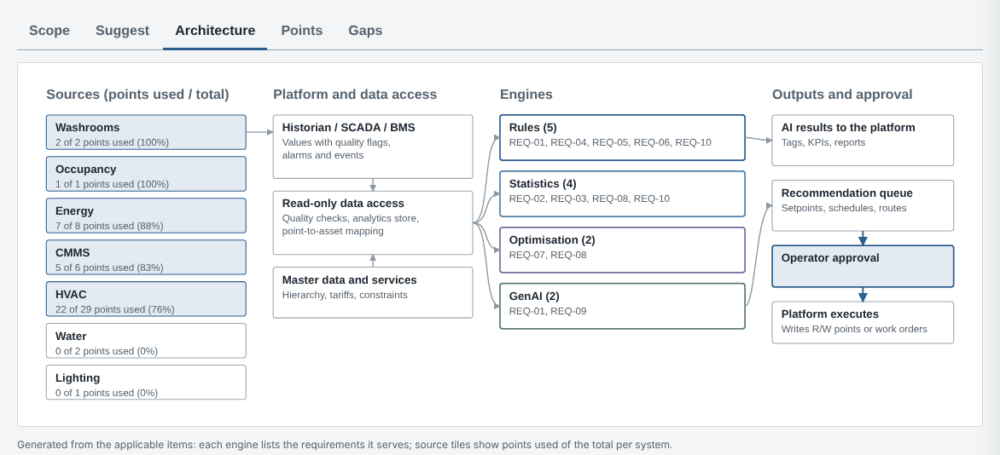

<div align="center">


# PointProof

### *Every AI claim, proven point by point.*

[](https://github.com/flamewithcodeossoss/pointproof/actions/workflows/test.yml)
[](https://github.com/flamewithcodeossoss/pointproof)
[](https://www.python.org/)
[](LICENSE)
[](skills/pointproof)
[](https://github.com/flamewithcodeossoss/pointproof/pulls)

**PointProof** is an open-source agent skill and toolkit for scoping AI on real sites: buildings, water networks, utilities, industrial plants and data centres.

Give it a site's points list in almost any format (BMS or SCADA schedules, historian tag exports, BACnet EDE, Brick, Project Haystack, OPC UA) and a list of AI requirements from a tender or RFP. PointProof decides what can really be delivered, picks the simplest defensible method, binds every requirement to exact points from the client's own list, and refuses to let an invented point through. You review the result in an interactive studio and hand over an Excel proof sheet.

[Why PointProof?](#why-pointproof) • [How It Works](#how-it-works) • [Quickstart](#quickstart) • [Studio](#pointproof-studio) • [Method Ladder](#the-method-ladder) • [Use-Case Library](#built-in-use-case-library) • [CLI Reference](#cli-reference) • [Walkthrough](#example-walkthrough-northgate-office-campus) • [Contributing](#contributing)

</div>

---

## Table of Contents

- [Why PointProof?](#why-pointproof)
  - [The AI Scoping Trap](#the-ai-scoping-trap)
  - [The PointProof Guarantee](#the-pointproof-guarantee)
- [How It Works](#how-it-works)
  - [Pipeline Architecture](#pipeline-architecture)
  - [The Method Ladder](#the-method-ladder)
- [Quickstart](#quickstart)
  - [1. For Claude Code](#1-for-claude-code)
  - [2. For Universal Coding Agents (Codex, Cursor, OpenCode)](#2-for-universal-coding-agents-codex-cursor-opencode)
  - [3. For Python & CLI Users](#3-for-python--cli-users)
- [Supported Data Sources](#supported-data-sources)
- [PointProof Studio](#pointproof-studio)
- [Example Walkthrough: Northgate Office Campus](#example-walkthrough-northgate-office-campus)
- [The Report Structure](#the-report-structure)
- [Built-in Use-Case Library](#built-in-use-case-library)
- [The Optimisation Rung and Learning OR](#the-optimisation-rung-and-learning-or)
- [CLI Reference](#cli-reference)
- [Assessment Schema Specification](#assessment-schema-specification)
- [Development & Testing](#development--testing)
- [Roadmap](#roadmap)
- [Contributing](#contributing)
- [License & Disclaimers](#license--disclaimers)

---

## Why PointProof?

### The AI Scoping Trap

In smart facility tenders, utility RFPs and industrial automation bids, "Artificial Intelligence" requirements are routinely vague and over-scoped:

> *"The solution shall provide AI-driven predictive optimisation of the chiller plant, fault detection with root-cause identification, and automated work orders."*

Delivery teams responding to these tenders face two risks:

1. **The Over-Promise Trap**: promising neural networks or unconstrained GenAI copilots when the problem is already solved by engineering rules, classical statistics or a scheduling solver (ASHRAE Guideline 14 baselines, ISA-18.2 alarm management, trim-and-respond setpoint resets, technician rostering).
2. **The Telemetry Disconnect**: bidding on use cases that need specific points (kW sub-meters, outdoor air temperature, writable setpoints, work-order fields) without checking that those points exist in the site's schedule. When delivery starts, sensors are missing, setpoints are read-only and names are inconsistent.

### The PointProof Guarantee

| Traditional AI Bidding | PointProof Scoping |
|:---|:---|
| **Vague Promises**: generic slides claiming "state-of-the-art ML". | **Grounded**: every requirement cites exact, numbered point ids from the site's own list. |
| **Hallucinated Sensors**: algorithms assume data that does not exist on site. | **Zero tolerance**: if an agent or engineer references a point that is not in the list, validation fails. |
| **Black-Box Overkill**: deep models proposed where a degree-day regression or a solver does the job. | **The Method Ladder**: rules before statistics, statistics before optimisation, optimisation before ML. |
| **Costly Scope Creep**: missing hardware discovered months into delivery. | **Upfront Gap Analysis**: missing points and master data are listed in the report and the studio. |
| **Manual Spreadsheet Juggling**: hours cross-referencing I/O schedules by hand. | **Any source in seconds**: CSV, Excel, PDF, tag exports, EDE, Brick, Haystack and OPC UA are read and normalised automatically. |

---

## How It Works

PointProof works as an **agent skill** (Claude Code, Cursor, Codex and other assistants that read Agent Skills) and as a **command-line toolkit** you can run yourself. When information is missing, the agent asks at most four questions (domain, data source, highest method the team delivers, team capacity), proposes a shortlist and lets you move items in or out.

### Pipeline Architecture



---

### The Method Ladder

PointProof applies **Occam's razor** to every requirement: *choose the lowest rung that meets it*.



#### Decision Matrix

| Rung | Method | Use When | Examples |
|:---:|:---|:---|:---|
| **1** | `rules` | A physical relation, arithmetic or Boolean logic answers the requirement. | Equipment running out of hours; chilled-water trim-and-respond; wasted energy per fault; DMA water balance. |
| **2** | `statistics` | It needs a fitted line, a percentile or median, or a running sum, with no training pipeline. | Weather-normalised baselines (IPMVP Option C, ASHRAE Guideline 14); CUSUM meter drift; ISA-18.2 alarm KPIs; minimum night flow. |
| **3** | `optimisation` | The answer is a decision among many combinations under limits (people, hours, trucks, budget, capacity). | Technician scheduling; work-order assignment; bin collection routing; retrofit selection within a budget; pump scheduling against tariff. |
| **4** | `ml` | Accuracy depends on learning non-linear patterns that need training, validation and drift tracking. | Day-ahead load forecasting; failure prediction (remaining useful life); vibration-based maintenance. |
| **+** | `genai` | Human language is involved in the input or the output. | Plain-language questions over the points; shift and incident summaries; work-order drafts. |

> [!NOTE]
> `genai` never replaces the numbers; it sits on top of whichever rung computes them. Call a regression baseline "statistics" and a solver "optimisation", never "an AI model".

---

## Quickstart

### 1. For Claude Code

PointProof is packaged as a Claude Code plugin and skill.

```bash
# Add the marketplace and install
/plugin marketplace add flamewithcodeossoss/pointproof
/plugin install pointproof@pointproof
```

Then, in any conversation:

```text
Use pointproof on the attached EDE export and the tender's AI section.
We deliver rules, statistics and optimisation; no ML. Capacity: 8 items.
```

### 2. For Universal Coding Agents (Codex, Cursor, OpenCode)

PointProof follows the Agent Skills standard:

```bash
npx skills add flamewithcodeossoss/pointproof --skill pointproof
```

Or copy `skills/pointproof/` into your agent's skills folder:
- Claude Code: `~/.claude/skills/pointproof`
- Cursor / OpenCode / Antigravity: `.agents/skills/pointproof` or `.gemini/skills/pointproof`

### 3. For Python & CLI Users

Install the dependencies (Python 3.9+):

```bash
git clone https://github.com/flamewithcodeossoss/pointproof.git
cd pointproof
pip install -r requirements.txt
```

Run the pipeline yourself:

```bash
S=skills/pointproof/scripts
E=examples/office-campus

# 1. Parse the points source (format is detected)
python $S/parse_points.py $E/points.csv --out points.json

# 2. Match the use-case library
python $S/match_usecases.py points.json --domain buildings,utilities,general --out candidates.json

# 3. Validate the assessment against the points
python $S/validate.py $E/assessment.json points.json

# 4. Open the interactive studio
python $S/build_studio.py --assessment $E/assessment.json --points points.json --out studio.html

# 5. Build the Excel proof sheet
python $S/build_report.py $E/assessment.json points.json --out PointProof_report.xlsx
```

No install needed to try the studio: open `examples/office-campus/studio.html` or `examples/water-network/studio.html` in a browser.

---

## Supported Data Sources

| Source | Files | How it is read |
|:---|:---|:---|
| Points schedules and I/O lists | `.csv` `.tsv` `.txt` `.xlsx` `.xlsm` `.pdf` | Delimiter and encoding (UTF-8, Windows-1252) detected; header found by synonyms, also inside longer headers (`Tag Name (DBO)`); best workbook sheet picked automatically |
| Historian / PI / SCADA tag exports | `.csv` | Tag, description and units columns; the asset comes from the tag prefix (`AHU01.SAT` → `AHU01`) |
| BACnet EDE | `.csv` (semicolon) | Object types and unit codes decoded; AO, BO, MO and settable values are writable |
| Brick | `.ttl` `.rdf` `.jsonld` | Points and the equipment they belong to (needs `rdflib`) |
| Project Haystack | `.json` (grid v3 or Hayson) | Marker tags become the point name; `writable`, `sp` and `cmd` are writable |
| OPC UA NodeSet2 | `.xml` | Variables, their parent object, access level and engineering units |

Names are normalised before matching: accents dropped, camelCase split, abbreviations expanded (`SAT`, `CHWST`, `SP`, `kW`…). `AHU01.SATSP`, `Supply Air Temp SP` and `supplyAirTemperatureSetpoint` all read *supply air temperature setpoint*. When a system column is missing, the system is inferred from the equipment and tag.

---

## PointProof Studio

A single HTML file, built from an assessment and a points list, that runs in any browser with nothing to install.



| Tab | What you do there |
|:---|:---|
| **Scope** | Switch each requirement in or out; filter by group, method or issues; open one to edit its method, points (proved live against the list), logic, outputs and out-of-scope reason |
| **Suggest** | Library use cases matched against your points (ready / partial / blocked); add one as a draft requirement |
| **Architecture** | A diagram generated from the applicable items: sources with points used, engines per method, approval flow |
| **Points** | Every point, which requirement uses it, and points used per system |
| **Gaps** | Proof errors, missing data and capacity overflow |

The side panel sets the delivery policy (rungs above it are flagged) and a team capacity. Drop a new points file onto the page (CSV, tag export, EDE, Haystack JSON, OPC UA NodeSet or `points.json`) to re-check everything against it. Export `assessment.json` (feed it back to `validate.py`), Excel, CSV, a PDF report, or the studio itself with your changes. Edits stay in your browser until you export.



---

## Example Walkthrough: Northgate Office Campus

The repository includes **Northgate Office Campus**, a fictional office building with a vendor-style tag list. A second example, **Riverside Water Network** (`examples/water-network/`), shows a SCADA list for a water utility.

### The Challenge

- **Points list**: 49 tags (`AHU1.SATSP`, `CH1.CHWSTSP`, `MTR.MAIN.KWH`…) across HVAC, energy meters, lighting, people counting, water, washrooms and the CMMS.
- **Tender scope**: 13 AI and analytics requirements.
- **Delivery policy**: the team delivers rules, statistics and optimisation, but not ML (`max_method: optimisation`).

### The Execution

1. **Parse**:
   ```bash
   python skills/pointproof/scripts/parse_points.py examples/office-campus/points.csv --out points.json
   ```
   *Output*: 49 points across 7 systems (29 HVAC, 8 Energy, 6 CMMS, 2 Water, 2 Washrooms, 1 Lighting, 1 Occupancy); 9 writable.

2. **Match**:
   ```bash
   python skills/pointproof/scripts/match_usecases.py points.json --domain buildings,utilities,general --out candidates.json
   ```
   *Output*: 33 use cases checked; 31 ready, 2 blocked (no bin fill sensors, no solar meter).

3. **Validate**:
   ```bash
   python skills/pointproof/scripts/validate.py examples/office-campus/assessment.json points.json
   ```
   ```text
   13 items: 10 applicable, 3 out of scope; 37 distinct points referenced; policy max method: optimisation
   PASSED: every referenced point exists in the points list
   ```

4. **Review and deliver**: open the studio, adjust, export; then build the Excel sheet:
   ```bash
   python skills/pointproof/scripts/build_report.py examples/office-campus/assessment.json points.json --out PointProof_report.xlsx
   ```

### The Result


---

## The Report Structure

`PointProof_report.xlsx` is one print-ready landscape A3 sheet in five sections:

```
┌────────────────────────────────────────────────────────────────────────────────────────┐
│  Northgate Office Campus (fictional demo) — AI use cases proven against the points list│
│  Applicable 10  |  Out of scope 3  |  Total requirements 13                            │
├────────────────────────────────────────────────────────────────────────────────────────┤
│  A. APPLICABLE                                                                         │
│  [Ref] [Requirement] [Method and why] [Input points] [Other inputs] [Logic] [Output]    │
│  [Example output] [Runs] [History needed]                                              │
│  • REQ-02 Weather-corrected energy (STATISTICS) → #30 MTR.MAIN.KWH, #29 WS.OAT ...      │
│  • REQ-04 Chilled-water reset (RULES) → #24 CH1.CHWSTSP (R/W), #6 AHU1.CLGVLV ...       │
│  • REQ-07 Maintenance scheduling (OPTIMISATION) → #44 CMMS.WO.ID, #27 CH1.FLT ...       │
├────────────────────────────────────────────────────────────────────────────────────────┤
│  B. OUT OF SCOPE                    [Ref] [Requirement] [Reason]                       │
│  • REQ-12 Next-day building load forecast — needs a trained ML model                   │
├────────────────────────────────────────────────────────────────────────────────────────┤
│  C. MISSING POINTS AND DATA TO REQUEST                                                 │
│  • REQ-07 Technician skills and shift rota (CMMS master data)                          │
├────────────────────────────────────────────────────────────────────────────────────────┤
│  D. POINTS USED PER SYSTEM          [System] [Points in list] [Used] [Share used]      │
├────────────────────────────────────────────────────────────────────────────────────────┤
│  E. ARCHITECTURE                    [Layer] [What it does] [Data] [Owner]              │
└────────────────────────────────────────────────────────────────────────────────────────┘
```

---

## Built-in Use-Case Library

PointProof ships with **51 use cases in six domains**, one YAML file per domain in [`references/usecases/`](skills/pointproof/references/usecases/). Each defines required and optional point slots with name patterns, optional units patterns, equipment filters and exclude rules, plus the method, logic, output and data history it needs. Choose domains with `--domain`, or add your own pack with `--library`.

| Domain | ID | Title | Method |
|:---|:---|:---|:---|
| Buildings | `energy-baseline` | Weather-normalised energy baseline | `statistics` |
| Buildings | `meter-balance-drift` | Sub-meter reconciliation against the main meter | `statistics` |
| Buildings | `portfolio-benchmarking` | Energy use intensity benchmark across buildings | `statistics` |
| Buildings | `fault-energy-cost` | Wasted energy and cost per active fault | `rules` |
| Buildings | `ecm-out-of-hours` | Equipment running outside its schedule | `rules` |
| Buildings | `ecm-unoccupied-conditioning` | Conditioning or lighting unoccupied zones | `rules` |
| Buildings | `ecm-excess-fresh-air` | Excess fresh air | `rules` |
| Buildings | `chw-setpoint-reset` | Chilled-water supply setpoint reset (rule-based) | `rules` |
| Buildings | `zone-setback` | Unoccupied zone setpoint setback | `rules` |
| Buildings | `alarm-kpis` | Alarm system performance (ISA-18.2 KPIs) | `statistics` |
| Buildings | `maintenance-prioritisation` | Maintenance priority score from faults and run hours | `rules` |
| Buildings | `work-order-prioritisation` | Open work orders ranked by criticality and SLA | `rules` + `statistics` |
| Buildings | `carbon-trajectory` | Emissions tracking against a reduction target | `statistics` |
| Buildings | `retrofit-roi` | Retrofit payback from the measured baseline | `rules` |
| Buildings | `copilot-nlq` | Natural-language copilot over the points | `genai` |
| Buildings | `incident-timeline` | Incident summary drafted from alarms and work orders | `genai` |
| Buildings | `equipment-degradation` | Efficiency drift against commissioning (kW/TR, delta-T) | `statistics` |
| Buildings | `demand-forecast` | Day-ahead building load forecast | `ml` |
| Buildings | `remaining-useful-life` | Failure prediction (remaining useful life) | `ml` |
| Buildings | `occupancy-forecast` | Occupancy forecast by space | `ml` |
| Buildings | `maintenance-scheduling` | Maintenance scheduling to technicians and days | `optimisation` |
| Buildings | `work-order-assignment` | Work-order assignment to teams | `optimisation` |
| Buildings | `retrofit-portfolio` | Retrofit selection within a budget | `optimisation` |
| Buildings | `consumables-reorder` | Consumables reorder points and order quantities | `optimisation` |
| Buildings | `waste-collection-routing` | Bin collection planning and routing | `statistics` + `optimisation` |
| Buildings | `cleaning-rostering` | Cleaning rota driven by footfall | `statistics` + `optimisation` |
| Water networks | `dma-water-balance` | District metered area water balance (non-revenue water) | `rules` |
| Water networks | `minimum-night-flow` | Leak detection from minimum night flow | `statistics` |
| Water networks | `burst-detection` | Burst detection from flow and pressure | `statistics` |
| Water networks | `tank-level-management` | Reservoir and tank level management | `rules` |
| Water networks | `pump-scheduling-tariff` | Pump scheduling against tariff and tank limits | `optimisation` |
| Water networks | `pressure-management` | Pressure management by zone | `rules` |
| Water networks | `water-demand-forecast` | Water demand forecast | `ml` |
| Utilities and energy | `peak-demand-alerts` | Peak demand alerts | `rules` |
| Utilities and energy | `power-quality` | Power factor and voltage monitoring | `rules` |
| Utilities and energy | `solar-performance-ratio` | Solar performance ratio | `statistics` |
| Utilities and energy | `load-shifting-tariff` | Load shifting and battery dispatch against tariff | `optimisation` |
| Utilities and energy | `energy-load-forecast` | Short-term load forecast | `ml` |
| Industrial | `oee` | Overall equipment effectiveness (OEE) | `rules` |
| Industrial | `spc-control-charts` | Statistical process control | `statistics` |
| Industrial | `energy-per-unit` | Energy per unit produced | `statistics` |
| Industrial | `compressed-air-leaks` | Compressed air leak detection | `statistics` |
| Industrial | `production-scheduling` | Production scheduling | `optimisation` |
| Industrial | `vibration-predictive-maintenance` | Vibration-based predictive maintenance | `ml` |
| Data centres | `pue` | Power usage effectiveness (PUE) | `rules` |
| Data centres | `rack-inlet-compliance` | Rack inlet temperature compliance | `rules` |
| Data centres | `cooling-setpoint-raise` | Cooling setpoint raise recommendations | `rules` |
| Data centres | `capacity-planning` | Power and cooling capacity headroom | `statistics` |
| Data centres | `workload-cooling-placement` | Workload placement for power and cooling | `optimisation` |
| General (any site) | `sensor-data-quality` | Sensor and data-quality checks | `rules` |
| General (any site) | `short-cycling` | Equipment short-cycling | `rules` |

---

## The Optimisation Rung and Learning OR

Optimisation use cases name their model, and [`scripts/optimise/`](skills/pointproof/scripts/optimise/) has a small, runnable OR-Tools reference model for each kind:

| Script | Question | OR model |
|:---|:---|:---|
| `reorder.py` | When to reorder consumables, and how many? | Inventory (s, Q) policy, EOQ |
| `budget_select.py` | Which retrofits to fund within a budget? | 0/1 knapsack (CP-SAT) |
| `schedule_maintenance.py` | Who fixes what, and which day? | Assignment with capacity (CP-SAT) |
| `route_collection.py` | Which bins are due, and in what order? | Capacitated vehicle routing (CVRP) |

They run on fictional data in `examples/or/` and double as a hands-on course: see [docs/learn-or.md](docs/learn-or.md) for the concepts, exercises and where to study further.

---

## CLI Reference

All scripts live in [`skills/pointproof/scripts/`](skills/pointproof/scripts/) and run on Python 3.9+.

### `parse_points.py`

Normalises any points source into `points.json`.

```bash
python parse_points.py SOURCE [--format auto|table|brick|haystack|ede|opcua] [--sheet NAME] [--out points.json] [--map field=Header ...]
```

- `SOURCE`: any file from [Supported Data Sources](#supported-data-sources); the format is detected unless `--format` is given.
- `--sheet NAME`: worksheet to read (default: the sheet with the best header row, so cover and revision sheets are skipped).
- `--out PATH`: destination (default `points.json`); parent folders are created.
- `--map field=Header`: column overrides for tables, e.g. `--map name="BACnet Tag" equipment="Asset Class"`. Unknown fields and missing headers are rejected.
- **Fields**: `id`, `system`, `equipment`, `description`, `name`, `rw`, `units`, `asset`.
- **`rw`** is normalised to `R`, `W`, `R/W` or empty (unknown) from values such as `Read/Write`, `RW`, `RO`, `Input`/`Output`, or I/O types `AI` `AO` `BI` `BO` `DI` `DO` `AV` `BV`.
- **Repeated ids** (numbering that restarts per panel) are kept as `12-2` with a warning; exact duplicate rows are dropped.

### `match_usecases.py`

Screens the points against the use-case library.

```bash
python match_usecases.py points.json [--domain buildings,water,...] [--library DIR_OR_FILE ...] [--add-builtin] [--out candidates.json]
```

- `--domain`: limit to `buildings`, `water`, `utilities`, `industrial`, `datacentres`, `general` (default: all).
- `--library`: a library folder or YAML pack; repeat to combine packs (a later pack replaces a use case with the same id). `--add-builtin` loads the built-in library first.
- **Statuses**: `ready` (every required slot has a point), `partial` (some), `blocked` (none).
- **Writable slots**: points with no read/write data are kept, listed in `writable_unknown_ids` and the slot is marked `writable_unverified`; confirm write access before promising a setpoint change.

### `validate.py`

The integrity gate: no invented points, no method above the policy.

```bash
python validate.py assessment.json points.json [--max-method rules|statistics|optimisation|ml]
```

Fails (exit code 1) when a cited point id is not in `points.json`, a cited name differs from the list, an applicable item has no points and no `no_points_reason`, a method is above the policy, a ref repeats, a verdict is unknown, or the policy itself is not a known rung.

### `build_studio.py`

Builds PointProof Studio as one self-contained HTML file.

```bash
python build_studio.py [--assessment assessment.json] [--points points.json] [--domain ...] [--out studio.html]
```

Both inputs are optional: with only points it opens on the Suggest tab; with neither, drop files onto the page.

### `build_report.py`

Builds the one-sheet Excel proof.

```bash
python build_report.py assessment.json points.json [--out PointProof_report.xlsx]
```

It runs the validator first and stops if validation fails.

---

## Assessment Schema Specification

The agent (or the studio) writes `assessment.json`; the full field list is in [`references/assessment_schema.md`](skills/pointproof/references/assessment_schema.md).

```json
{
  "project": "Northgate Office Campus (fictional demo)",
  "points_source": "points.csv",
  "policy": {"max_method": "optimisation"},
  "capacity": 10,
  "items": [
    {
      "ref": "REQ-02",
      "title": "Weather-corrected monthly energy performance",
      "group": "Energy",
      "verdict": "applicable",
      "usecase": "energy-baseline",
      "method": ["statistics"],
      "why": "A regression of daily energy on cooling degree days and occupancy; no ML training.",
      "points": [
        {"id": 30, "name": "MTR.MAIN.KWH"},
        {"id": 29, "name": "WS.OAT"},
        {"id": 39, "name": "PC.ENT.CNT"}
      ],
      "other_inputs": "Building calendar.",
      "logic": [
        "Daily kWh from the main incomer; drop days when the meter was offline.",
        "Cooling degree days from outside air temperature (base to confirm).",
        "Fit kWh = a + b × CDD + c × people on 12 months; accept only if ASHRAE Guideline 14 limits are met.",
        "Monthly: actual vs expected, in kWh and %."
      ],
      "output": "Monthly table and tags: expected kWh, actual kWh, deviation %.",
      "example": "October: actual 212,400 kWh; expected 198,900 kWh; +6.8%.",
      "runs": "Daily; report monthly; refit quarterly",
      "history": "12 months"
    },
    {
      "ref": "REQ-12",
      "title": "Next-day building load forecast",
      "group": "Energy",
      "verdict": "out_of_scope",
      "reason": "Needs a trained forecasting model (ML); the policy stops at optimisation."
    }
  ],
  "architecture": [
    {"layer": "Field systems", "does": "BMS, meters and CMMS as in the points list", "data": "All points", "owner": "Site owner"},
    {"layer": "Analytics", "does": "Rules, statistics and optimisation jobs; GenAI for summaries", "data": "Read-only", "owner": "AI team"}
  ]
}
```

---

## Development & Testing

```bash
pip install -r requirements.txt
pytest -v
```

The test suite covers:
- Every supported source format, plus semicolon and Windows-1252 CSVs, non-ASCII names, tag-only lists, headers inside longer headers, workbook cover sheets and repeated ids.
- Name normalisation, accent folding, word-boundary patterns and units-based matching.
- Strict rejection of invented point ids, altered names, malformed entries and unknown policies.
- Policy enforcement across the method ladder, including the optimisation rung.
- The four OR-Tools models (budget, groups, capacity limits).
- The report (out-of-scope reasons, nested output folders) and the studio build (data embedding and escaping).

Every push and pull request runs the suite on GitHub Actions (`.github/workflows/test.yml`).

---

## Roadmap

- [x] Brick, Project Haystack, BACnet EDE and OPC UA ingestion
- [x] Water, utilities, industrial and data-centre use-case packs
- [x] Interactive studio
- [ ] Export runnable rule packs (Python / SQL) for the applicable `rules` items
- [ ] Haystack Zinc grids and Brick model validation
- [ ] Localised report sheets (Arabic, French, Spanish, German)
- [ ] Live connectors: BACnet/IP discovery and MQTT Sparkplug

---

## Contributing

Contributions from building automation engineers, energy and water analysts, controls specialists and AI practitioners are welcome.

### How to Add a New Use Case

The most valuable contribution is a new use case in the right file of [`skills/pointproof/references/usecases/`](skills/pointproof/references/usecases/):

1. **Pick an established method** (ASHRAE, ISA, IPMVP, IWA, a standard OR model).
2. **Define point slots** with clear name patterns (and units patterns where they help).
3. **Choose the lowest rung** on the method ladder that meets it.
4. **Keep it anonymous**: no client-specific or proprietary point tags or data.
5. **Add a test** in `tests/test_pointproof.py` showing your slot patterns match.

New readers go in `scripts/adapters.py`, with a small sample in `examples/formats/`. See the [Contributing Guidelines](CONTRIBUTING.md).

---

## License & Disclaimers

- **License**: released under the [MIT License](LICENSE).
- **Demo sites**: Northgate Office Campus and Riverside Water Network, and their points and requirements, are fictional, made for demonstration and tests.
- **Standards**: PointProof is an independent open-source project. Standards (ASHRAE, IPMVP, ISO, ISA, EEMUA, IWA) are cited for method references only.

---

<div align="center">
<sub>Built for the smart building, utility and industrial AI engineering community.</sub>
</div>
